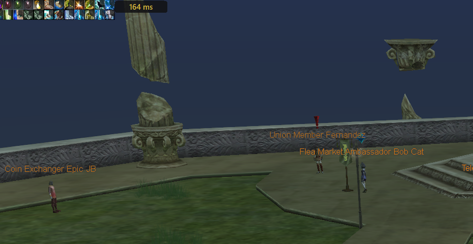

# Rappelz Ping (Türkçe)

[English](README.md)

Rappelz Ping, oyunun **o an bağlı olduğu sunucuya gerçek pingini** oyunun üstünde küçük bir
kutuda gösterir. Kurulum yok, tek exe.

1. [Releases](https://github.com/TheBatur/rappelz-ping/releases/latest) sayfasından `RappelzPing.exe`'yi indir, çift tıkla.
2. Yönetici izni sorarsa **Evet** de (oyunun kendisi de aynı izni ister).
3. "Windows bilgisayarınızı korudu" çıkarsa: **Ek bilgi → Yine de çalıştır** (exe imzasız).
4. Kutuyu sürükleyerek istediğin yere koy. Sağ tık: konumu sıfırla, anonim sayımı aç/kapat,
   hakkında, kapat.

Sunucuya fazladan hiçbir şey göndermez; Windows'un oyunun bağlantısı için zaten tuttuğu
gecikme istatistiklerini okur. Windows dilin Türkçeyse program da Türkçe görünür.
Anonim kullanım sayısı yalnızca rastgele bir kimlik, sürüm, kullanım süresi ve ping özetinden
oluşur; IP adresin, adın ya da bilgisayar bilgilerin saklanmaz.

Ayrıntılar (nasıl ölçtüğü, gizlilik, derleme) için [İngilizce README](README.md).
